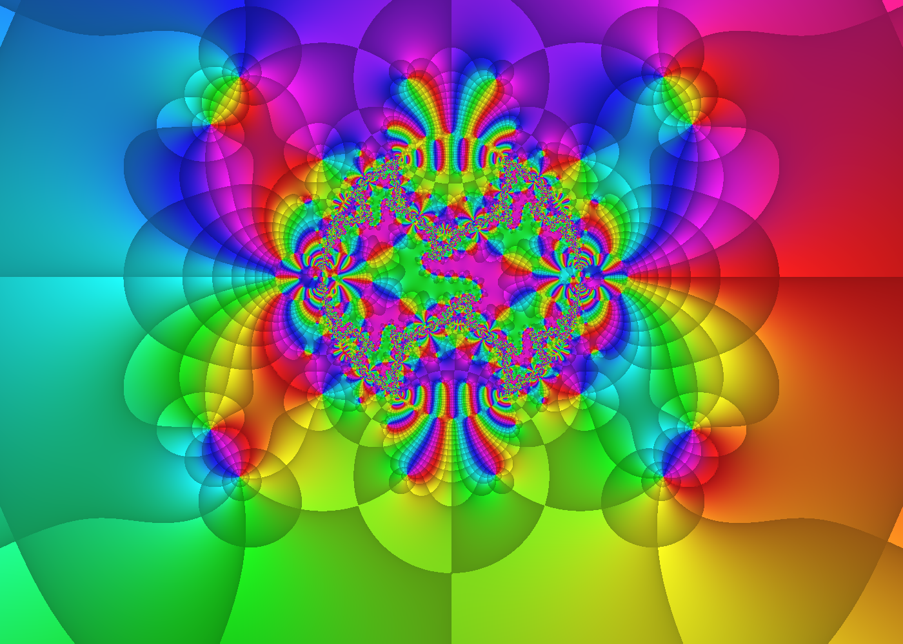
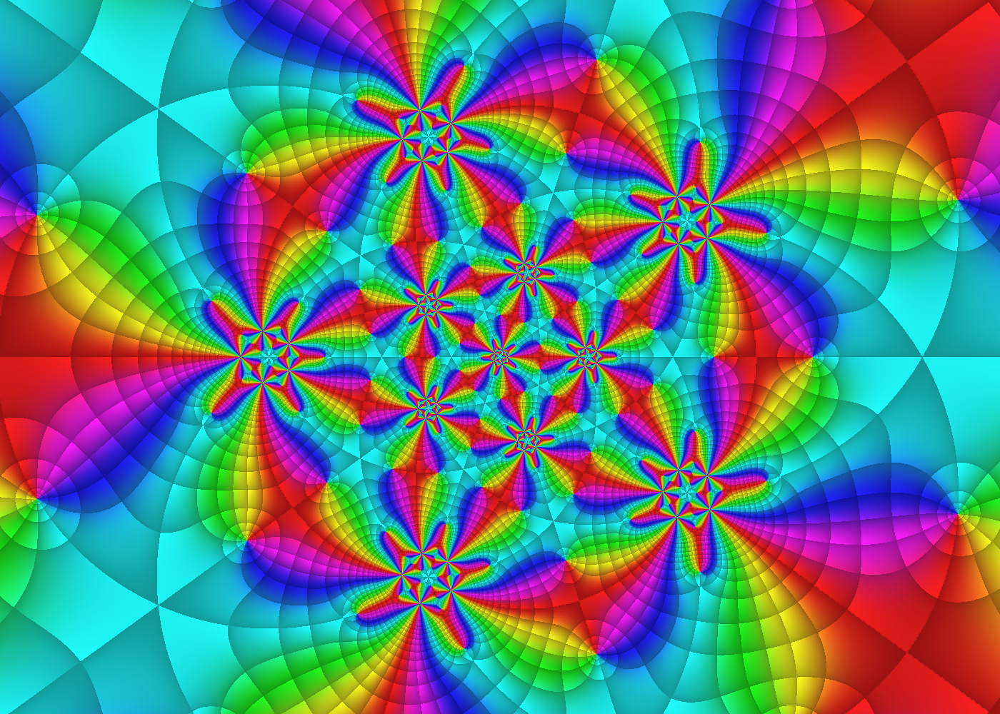
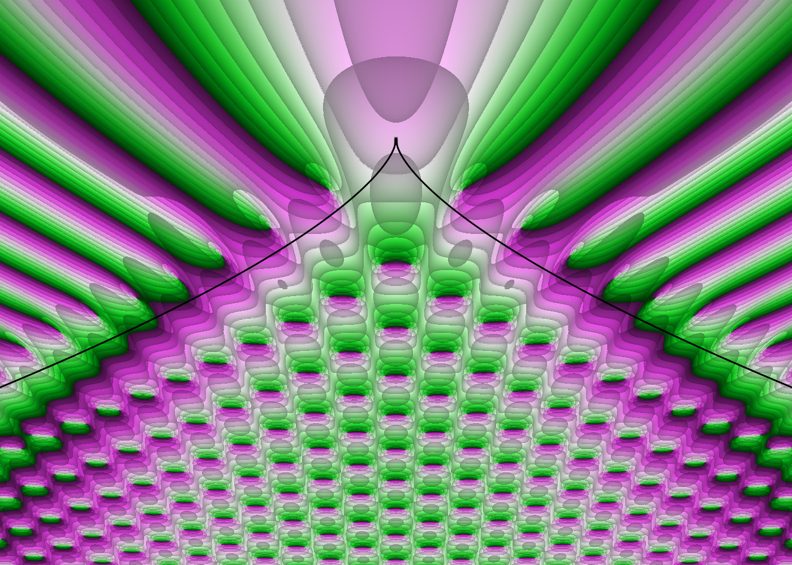
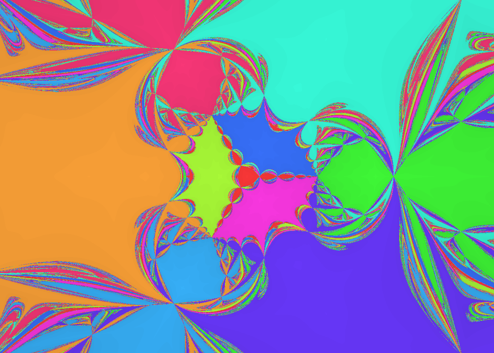
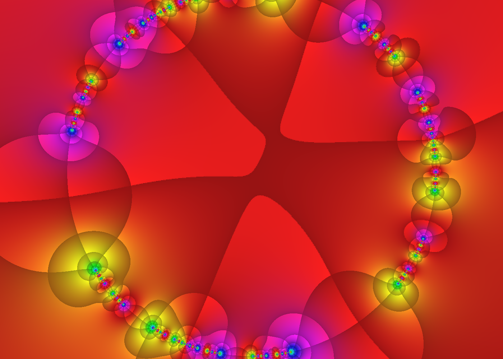

# Complex Plot Shader

Interactive domain coloring of the automorphic function
$`f(z) = \frac{P_{-1,-3}(z)}{P_{0,-4}(z)}`$ for a two-generator Kleinian group,
approximated by a finite Poincaré series.



Run `native\build\poincare.exe`, or open `js/index.html` in the browser.

See [docs/background.md](docs/background.md) for more information.

## Icosahedral group

Domain coloring of an automorphic function for the 60 rotations of the
icosahedron, displayed on the complex plane or the Riemann sphere.



Run `native\build\icosahedral.exe`, or choose **Icosahedral** in the browser's
Group menu. Press **S** to switch to the Riemann sphere.

See [docs/coxeter.md](docs/coxeter.md) for more information.

## Pearcey integral

Phase portrait of the Pearcey integral, which describes the wave field near
a cusp caustic.



Run `native\build\pearcey.exe`.

See [docs/pearcey/](docs/pearcey/README.md) for more information.

## Kantorovich theorem and harmonic Newton iteration

Phase portrait, Newton displacement, and root attraction basins of the
harmonic function from the Kantorovich illustration.



Run `native\build\kantorovich.exe --fp64`. Press **F** to cycle through the plots.

See [docs/kantorovich.md](docs/kantorovich.md) for more information.

## Inner function phase portrait

Phase portrait of a singular inner function with a Cantor measure on the
unit circle, showing the interior and exterior of the disk.



Run `native\build\inner.exe`. Press **F** to compare the Cantor portrait,
a single-atom example, and a Blaschke factor.

See [docs/inner.md](docs/inner.md) for more information.

## Native Windows renderer

Requires Visual Studio or Build Tools with the MSVC x64 C++ toolchain, the Windows SDK, and a DirectX 12 GPU with double-precision shader support (Windows 10/11).

There are five programs:

| Program | Plot | Default center |
|---|---|---|
| `native\build\poincare.exe` | Kleinian $`\langle g_1, g_2 \rangle`$, truncated Poincaré series | `0 -0.35` |
| `native\build\icosahedral.exe` | 60 icosahedral rotations, exact sum | `0 0` |
| `native\build\pearcey.exe` | Pearcey integral, quadrature per pixel | `0 -5` |
| `native\build\kantorovich.exe` | Harmonic function and Newton basins | `0 0` |
| `native\build\inner.exe` | Cantor singular inner function, inside and outside the unit disk | `0 -0.04` |

Run `native\dx12\build.bat` to build all five, or `native\dx12\build.bat poincare` /
`icosahedral` / `pearcey` / `kantorovich` / `inner` to build one. All build outputs (`.exe`, `.lib`,
`.exp`, `.obj`) go to `native\build\`.
Group elements are enumerated on the CPU; HLSL compute shaders sum the series per pixel.
DirectX 12 handles GPU buffers, domain coloring, and presentation. Both summation modes
accumulate into a double-precision buffer.

Close the running executable before rebuilding, or pass an alternate output name,
for example `native\dx12\build.bat poincare poincare-dx12.exe`.

Optionally set the initial view from the command line:

```powershell
.\native\build\poincare.exe --center 0 -0.35 --span 5
.\native\build\poincare.exe --center 0.2 -0.6 --span 1.5 --terms 20000 --fp64 --snapshot zoom.png
.\native\build\icosahedral.exe --snapshot icosahedral.png
.\native\build\icosahedral.exe --sphere --center 1.5 0.8 --snapshot sphere.png
.\native\build\pearcey.exe --function 1 --snapshot pearcey.png
```

`--center <real> <imag>` sets the complex center.
`--span <value>` sets the extent of the shorter window dimension in complex-plane
units (default: `5`); it must be finite and positive. The other dimension follows
the window aspect ratio. Both options are optional. `--function <0|1|2>` picks the
displayed function. `--colors <hue|greenpink>` picks the phase colours (the inner function defaults to GreenPinkTones,
all other programs to the hue wheel). `--terms` exists for `poincare.exe` and `pearcey.exe`, and `--sphere` (start in the Riemann sphere view, with `--center`
facing the viewer) only for `icosahedral.exe`. Run either program with `--help` for all options.

Controls (all programs):

- Drag to pan; scroll to zoom.
- `+` / `-`: double / halve the number of terms (`poincare.exe` and `pearcey.exe`).
- `D`: toggle fp32 / fp64 summation.
- `M`: cycle plot styles; `F`: cycle displayed functions.
- `C`: switch phase colours between the hue wheel and GreenPinkTones.
- `[` / `]`: adjust contour density; `R`: reset the view.
- `S`: toggle complex plane / Riemann sphere (`icosahedral.exe` only). On the
  sphere, drag rotates and scroll zooms.
- `I`: print an invariance check; `P`: save a PNG.
- `Esc`: quit.

To validate GPU sums against the CPU evaluator at three sample pixels:

```powershell
.\native\build\poincare.exe --terms 20000 --verify-gpu --snapshot check.png
.\native\build\poincare.exe --terms 1024 --fp64 --verify-gpu --snapshot check-fp64.png
.\native\build\icosahedral.exe --fp64 --verify-gpu --snapshot check-icosahedral.png
.\native\build\pearcey.exe --fp64 --verify-gpu --snapshot check-pearcey.png
```

## Native macOS renderer

The same four programs run on macOS with Metal. Build them with
`native/metal/build.sh` (or `native/metal/build.sh poincare` for one) and run
`native/build/poincare`, `icosahedral`, `pearcey` or `kantorovich` with the options
and keys above. Apple GPUs have no double precision, so `--fp64` / `D` use
double-float arithmetic (about 48 significant bits), which passes the same
`--verify-gpu` checks. See [native/metal/README.md](native/metal/README.md).

The Metal build also has `native/build/invariant_j`, Klein's modular $`j`$-invariant
on the upper half-plane (each pixel reduced to the fundamental domain of
$`\mathrm{SL}(2,\mathbb{Z})`$, then summed as a $`q`$-series); `F` cycles $`j`$, $`E_4`$ and $`E_6`$; `H` (or `--disk`) maps the half-plane onto the
Poincaré unit disk, with `--center` as its middle point.

## Browser renderer

Open `js/index.html` in a browser supporting WebGL2 and the `EXT_color_buffer_float` extension.
The page loads `complex.js` and `icosahedral.js` from the same folder.
Use the on-screen controls to adjust the plot.

## Source files

- `native/dx12/poincare/`: the Kleinian program.
  - `kleinian.h`: generators, reduced-word enumeration, and the CPU Poincaré series.
  - `poincare.cpp`: the group's HLSL term and display value, and `main`.
- `native/dx12/icosahedral/`: the icosahedral program.
  - `icosahedral.h`: the 60 rotations, `F`, `h`, and Klein's `J` on the CPU.
  - `icosahedral.cpp`: the group's HLSL term and display value, and `main`.
- `native/dx12/pearcey/`: the Pearcey integral program.
  - `pearcey.h`: the integration path, quadrature nodes, and the CPU reference.
  - `pearcey.cpp`: the HLSL integrand (with double-precision exp, sin and cos), the caustic overlay, and `main`.
- `native/dx12/common/`: code shared by the programs.
  - `app.h`: Win32 window, controls, command line, progressive rendering, GPU checks.
  - `shaders.h`: shared HLSL frame (summation loop and domain coloring) around each group's functions.
  - `dx12.h`: DirectX 12 device, pipelines, resource management, and readback.
  - `mobius.h`: SL(2,C) matrices and Möbius transformations.
  - `png.h`: dependency-free PNG writer.
- `native/dx12/build.bat`: builds one or all programs.
- `native/metal/`: Metal versions of the four programs for macOS; see [native/metal/README.md](native/metal/README.md).
- `js/index.html`: browser implementation (WebGL2 shaders, UI, Kleinian group).
- `js/complex.js`: complex numbers and Möbius matrices for the browser, shared by both groups.
- `js/icosahedral.js`: icosahedral group, `F`, `h`, Klein's `J`, and their GLSL snippets for the browser.
- `docs/background.md`: mathematical background.
- `docs/coxeter.md`: Coxeter groups and the icosahedral automorphic function.
- `docs/pearcey/`: the Pearcey integral: definition, integration path, quadrature, GPU evaluation, and verification.
