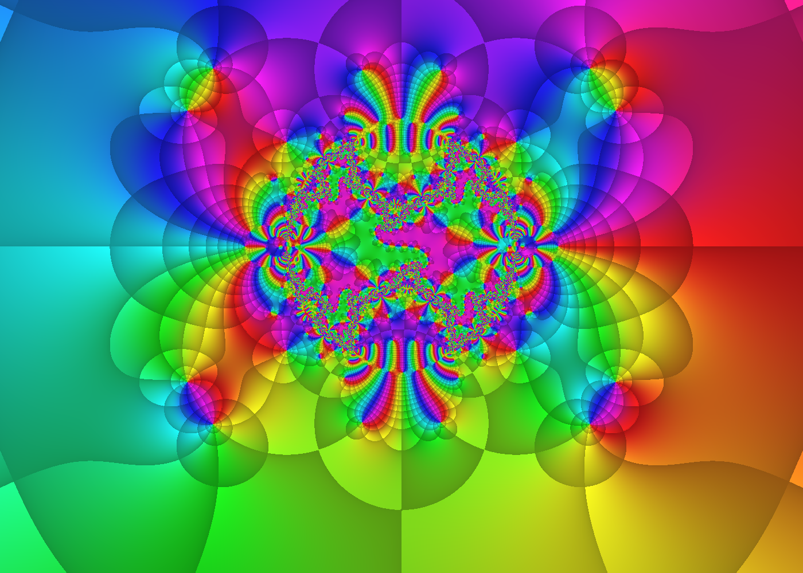
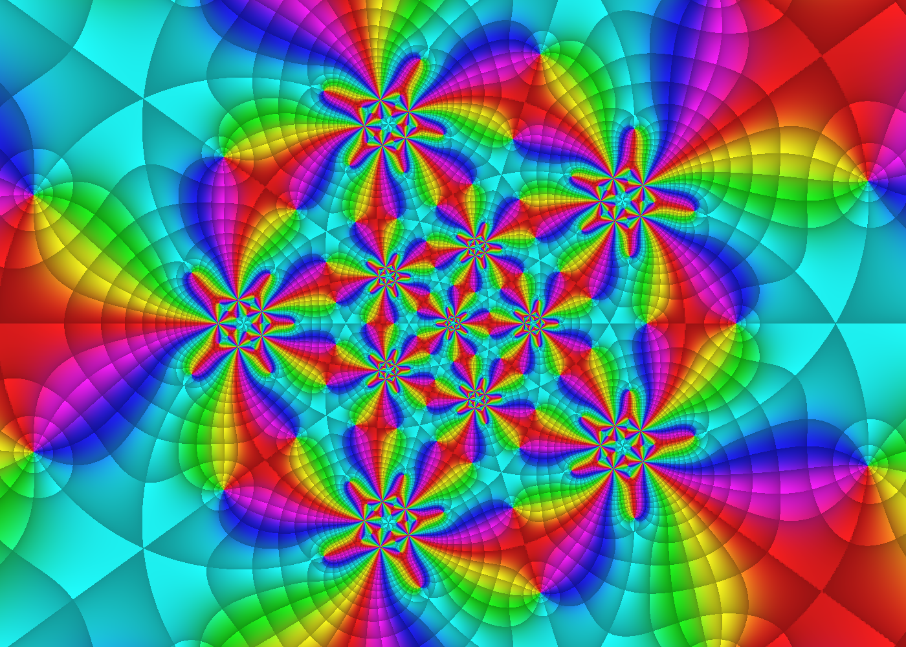
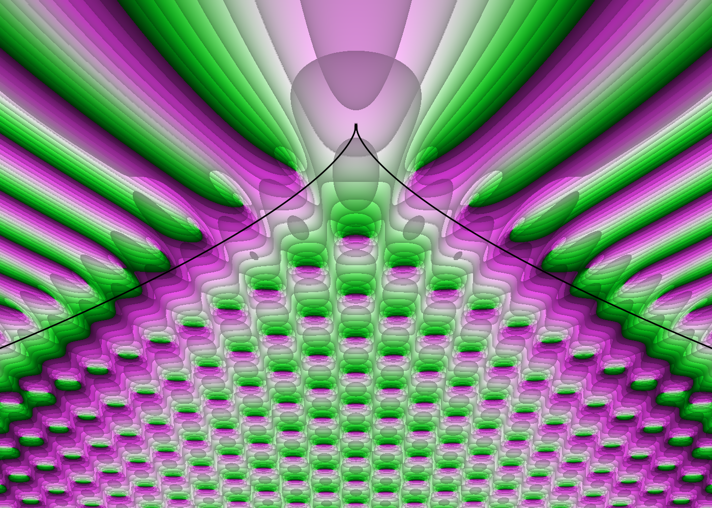

# Complex Plot Shader

Interactive domain coloring of the automorphic function
`f(z) = P_{-1,-3}(z) / P_{0,-4}(z)` for a two-generator Kleinian group.
Both renderers approximate the Poincaré series with a finite number of group elements.



DirectX 12 renderer preview using 20,000 terms at 1400 × 1000 pixels.

See [docs/background.md](docs/background.md) for the math: why `f` is invariant
under the group, how the series is truncated, and how to read the colors.

## Icosahedral group

Both renderers can also plot an automorphic function for the 60 rotations of the
icosahedron acting on the Riemann sphere:

`F(z) = Σ_{g∈G} h(g(z))`, with `h(z) = (z − 0.05)⁻⁵`.

The group is finite, so the sum is exact. The default view is `|Re z|, |Im z| < 2.5`.
Choose **Icosahedral** in the browser's Group menu, or run the separate native program
`native\build\icosahedral.exe`.
Its Function choices are `F`, the single term `h`, and Klein's invariant `J`.

The icosahedral plot can also be shown on the Riemann sphere. Choose
**View → Riemann sphere** in the browser, or press `S` in either the browser or
`icosahedral.exe` (or start it with `--sphere`). The sphere uses stereographic
projection from the south pole, `z = (X + iY)/(1 + Z)`, so 0 is the north pole and
∞ the south pole. Seen from outside, this keeps the plane's orientation rather than
mirroring it. Switching views keeps the point at the centre of the window. On the
sphere, drag rotates it and the scroll wheel zooms.



See [docs/coxeter.md](docs/coxeter.md) for Coxeter and triangle groups, Klein's
icosahedral invariants, and how this finite case relates to automorphic functions
on other Riemann surfaces.

## Pearcey integral

The native renderer also plots the Pearcey integral, which describes the wave field
near a cusp caustic:

`Ψ(x, y) = ∫ exp(i(t⁴ + y t² + x t)) dt` over the real line, as a function of `z = x + iy`.



Run `native\build\pearcey.exe`. The default view is `|x| < 10`, `−15 < y < 5` on the
shorter window side. Its Function choices are `Ψ`, `Ψ` with the caustic
`27x² + 8y³ = 0` drawn in black, and `∂Ψ/∂x`. `Ψ` is not analytic in `z`, so its
zeros (inside the cusp) are not all coloured the same way round.

The phase is coloured with the hue wheel, as in the other programs. Press `C` (or pass
`--colors greenpink`) for Mathematica's `ColorData["GreenPinkTones"]`: dark green at
`arg = −π`, near white at 0, dark magenta at `+π`. That scheme is not cyclic, so it has a
seam on the negative real axis.

The integrand does not decay on the real line, so each pixel integrates along a path
bent into the complex plane, `t(s) = s + iλ g/√(1 + g²)` with `g ∝ φ′(s)` and
`φ = t⁴ + y t² + x t`, on which `|exp(iφ)| ≤ 1` and the integrand dies off away from
the stationary points. The midpoint rule on this path converges exponentially; the
"terms" are its nodes (default 512, enough for double precision in the default view;
press `+` when zoomed far out). The node count is rounded up to a power of two, and
the nodes are summed in bit-reversed order so that a frame drawn part-way through the
sum, while dragging or resizing, is already a valid coarser quadrature. See [docs/pearcey/](docs/pearcey/README.md) for the integration path, the quadrature,
the double-precision GPU functions, and how the results are verified.

## Native Windows renderer

Requires Visual Studio or Build Tools with the MSVC x64 C++ toolchain, the Windows SDK, and a DirectX 12 GPU with double-precision shader support (Windows 10/11).

There are three programs:

| Program | Plot | Default center |
|---|---|---|
| `native\build\poincare.exe` | Kleinian ⟨g₁, g₂⟩, truncated Poincaré series | `0 -0.35` |
| `native\build\icosahedral.exe` | 60 icosahedral rotations, exact sum | `0 0` |
| `native\build\pearcey.exe` | Pearcey integral, quadrature per pixel | `0 -5` |

Run `native\dx12\build.bat` to build all three, or `native\dx12\build.bat poincare` /
`icosahedral` / `pearcey` to build one. All build outputs (`.exe`, `.lib`,
`.exp`, `.obj`) go to `native\build\`.
Group elements are enumerated on the CPU; HLSL compute shaders sum the series per pixel.
DirectX 12 handles GPU buffers, domain coloring, and presentation. Both summation modes
accumulate into a double-precision buffer.

Close the running executable before rebuilding, or pass an alternate output name,
for example `native\dx12\build.bat poincare poincare-dx12.exe`.

Optionally set the initial view from the command line:

```powershell
.\native\build\poincare.exe --center 0 -0.35 --span 5
.\native\build\poincare.exe --center 0.2 -0.6 --span 1.5 --terms 20000 --fp64 --snapshot zoom.png
.\native\build\icosahedral.exe --snapshot icosahedral.png
.\native\build\icosahedral.exe --sphere --center 1.5 0.8 --snapshot sphere.png
.\native\build\pearcey.exe --function 1 --snapshot pearcey.png
```

`--center <real> <imag>` sets the complex center.
`--span <value>` sets the extent of the shorter window dimension in complex-plane
units (default: `5`); it must be finite and positive. The other dimension follows
the window aspect ratio. Both options are optional. `--function <0|1|2>` picks the
displayed function. `--colors <hue|greenpink>` picks the phase colours (all programs
default to the hue wheel). `--terms` exists for `poincare.exe` and `pearcey.exe`, and `--sphere` (start in the Riemann sphere view, with `--center`
facing the viewer) only for `icosahedral.exe`. Run either program with `--help` for all options.

Controls (all programs):

- Drag to pan; scroll to zoom.
- `+` / `-`: double / halve the number of terms (`poincare.exe` and `pearcey.exe`).
- `D`: toggle fp32 / fp64 summation.
- `M`: cycle plot styles; `F`: cycle displayed functions.
- `C`: switch phase colours between the hue wheel (default) and GreenPinkTones.
- `[` / `]`: adjust contour density; `R`: reset the view.
- `S`: toggle complex plane / Riemann sphere (`icosahedral.exe` only). On the
  sphere, drag rotates and scroll zooms.
- `I`: print an invariance check; `P`: save a PNG.
- `Esc`: quit.

To validate GPU sums against the CPU evaluator at three sample pixels:

```powershell
.\native\build\poincare.exe --terms 20000 --verify-gpu --snapshot check.png
.\native\build\poincare.exe --terms 1024 --fp64 --verify-gpu --snapshot check-fp64.png
.\native\build\icosahedral.exe --fp64 --verify-gpu --snapshot check-icosahedral.png
.\native\build\pearcey.exe --fp64 --verify-gpu --snapshot check-pearcey.png
```

## Browser renderer

Open `index.html` in a browser supporting WebGL2 and the `EXT_color_buffer_float` extension.
Keep `complex.js` and `icosahedral.js` in the same folder; the page loads them.
Use the on-screen controls to adjust the plot.

## Source files

- `native/dx12/poincare/`: the Kleinian program.
  - `kleinian.h`: generators, reduced-word enumeration, and the CPU Poincaré series.
  - `poincare.cpp`: the group's HLSL term and display value, and `main`.
- `native/dx12/icosahedral/`: the icosahedral program.
  - `icosahedral.h`: the 60 rotations, `F`, `h`, and Klein's `J` on the CPU.
  - `icosahedral.cpp`: the group's HLSL term and display value, and `main`.
- `native/dx12/pearcey/`: the Pearcey integral program.
  - `pearcey.h`: the integration path, quadrature nodes, and the CPU reference.
  - `pearcey.cpp`: the HLSL integrand (with double-precision exp, sin and cos), the caustic overlay, and `main`.
- `native/dx12/common/`: code shared by the programs.
  - `app.h`: Win32 window, controls, command line, progressive rendering, GPU checks.
  - `shaders.h`: shared HLSL frame (summation loop and domain coloring) around each group's functions.
  - `dx12.h`: DirectX 12 device, pipelines, resource management, and readback.
  - `mobius.h`: SL(2,C) matrices and Möbius transformations.
  - `png.h`: dependency-free PNG writer.
- `native/dx12/build.bat`: builds one or all programs.
- `native/metal/`: planned Metal implementation for Apple silicon Macs (not started).
- `index.html`: browser implementation (WebGL2 shaders, UI, Kleinian group).
- `complex.js`: complex numbers and Möbius matrices for the browser, shared by both groups.
- `icosahedral.js`: icosahedral group, `F`, `h`, Klein's `J`, and their GLSL snippets for the browser.
- `docs/background.md`: mathematical background.
- `docs/coxeter.md`: Coxeter groups and the icosahedral automorphic function.
- `docs/pearcey/`: the Pearcey integral: definition, integration path, quadrature, GPU evaluation, and verification.
