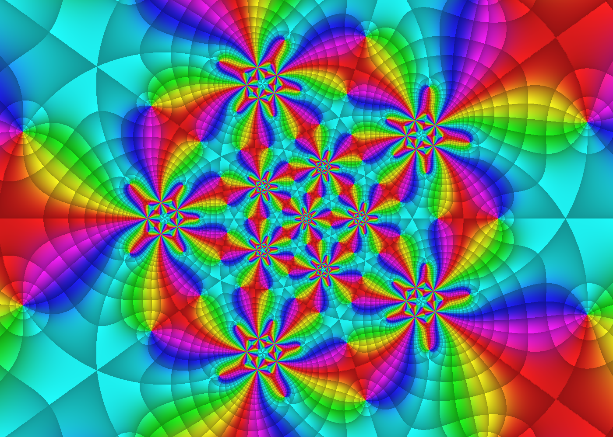

# Coxeter groups and automorphic functions on the Riemann sphere

This note explains the second picture the renderers can draw: an automorphic
function for the rotation group of the icosahedron. Switch to it with the
**Group** menu in `index.html`, or run the native program
`native\build\icosahedral.exe`. It also places that example in the wider theory of
Coxeter groups, triangle groups and automorphic functions on Riemann surfaces.
The formulas match `group`, `F`, `h` and `kleinJ` in `icosahedral.js` (browser)
and in the `icosahedral` namespace of `native/dx12/icosahedral/icosahedral.h` (native renderer).
Each file also holds the shader snippets that the renderer splices into its GPU code.



## Coxeter groups

A **Coxeter group** is a group with a presentation

```math
W = \big\langle\, r_1, \dots, r_n \;\big|\; (r_i r_j)^{m_{ij}} = 1 \,\big\rangle,
\qquad m_{ii} = 1,\quad m_{ij} = m_{ji} \in \{2, 3, \dots, \infty\}.
```

Each generator $`r_i`$ is an involution, and $`m_{ij}`$ is the order of the product of
two of them. The prototype is a group generated by reflections in the mirrors
of a polytope. If two mirrors meet at angle $`\pi/m`$, then the product of the two
reflections is a rotation by $`2\pi/m`$, so it has order $`m`$. The data is
recorded in a **Coxeter diagram**: one node per generator, and an edge labelled
$`m_{ij}`$ when $`m_{ij} \ge 3`$. Label 3 is usually left off, and $`m_{ij} = 2`$
(commuting mirrors) gets no edge.

Coxeter (1935) classified the finite ones. Every finite Coxeter group is a
product of irreducible ones from the list

```math
A_n,\; B_n,\; D_n,\; E_6,\; E_7,\; E_8,\; F_4,\; H_3,\; H_4,\; I_2(m).
```

These are exactly the finite groups generated by reflections of Euclidean space.

### Rank 3: triangle groups

With three generators, a Coxeter group is determined by three numbers
$`p, q, r`$. It is the group $`\Delta(p,q,r)`$ generated by reflections in the sides
of a triangle with angles $`\pi/p, \pi/q, \pi/r`$. The angle sum decides which
geometry the triangle lives in:

| $`\tfrac1p + \tfrac1q + \tfrac1r`$ | geometry | examples |
|---|---|---|
| $`> 1`$ | sphere (finite group) | $`(2,2,n)`$, $`(2,3,3)`$ tetrahedral, $`(2,3,4)`$ octahedral, $`(2,3,5)`$ icosahedral |
| $`= 1`$ | Euclidean plane | $`(3,3,3)`$, $`(2,4,4)`$, $`(2,3,6)`$ wallpaper groups |
| $`< 1`$ | hyperbolic plane | $`(2,3,7)`$, $`(2,4,5)`$, $`(2,3,\infty)`$ modular group |

Reflections reverse orientation. Products of an even number of them form the
index-2 **von Dyck group**

```math
D(p,q,r) = \langle\, a, b, c \mid a^p = b^q = c^r = abc = 1 \,\rangle.
```

Its generators are rotations about the three corners of the triangle, by
$`2\pi/p`$, $`2\pi/q`$ and $`2\pi/r`$.

## The icosahedral group $`H_3`$

The Coxeter group $`H_3 = [5,3]`$ has diagram `o—5—o—o`. It is the triangle group
$`\Delta(2,3,5)`$. Its fundamental triangle has angles $`\pi/2, \pi/3, \pi/5`$. On the
unit sphere such a triangle has area

```math
\pi\Big(\tfrac12 + \tfrac13 + \tfrac15 - 1\Big) = \frac{\pi}{30},
```

so $`4\pi \big/ \tfrac{\pi}{30} = 120`$ copies tile the sphere. $`H_3`$ is therefore the
full symmetry group of the icosahedron, of order 120 and isomorphic to
$`A_5 \times \mathbb{Z}_2`$. These are the 120 symmetries usually quoted for the
icosahedron.

The automorphic function, however, uses only the **orientation-preserving**
symmetries. This is not a choice; it is forced. Under stereographic projection, a reflection of the
sphere becomes an *anti*-holomorphic map such as $`z \mapsto \bar z`$. A
holomorphic function can only be invariant under holomorphic maps. So the group
used is the rotation subgroup

```math
G = D(2,3,5) \cong A_5, \qquad |G| = 60.
```

A third group of order 120 also appears. A rotation lifts to two matrices
$`\pm M \in \mathrm{SU}(2)`$, and the lifts of $`G`$ form the **binary icosahedral
group** $`2I \cong \mathrm{SL}(2, \mathbb{F}_5)`$. The code works with these matrices and
identifies $`M`$ with $`-M`$.

## Rotations as Möbius transformations

Stereographic projection identifies the unit sphere with the Riemann sphere
$`\hat{\mathbb{C}} = \mathbb{C} \cup \{\infty\}`$. Under it, $`\mathrm{SO}(3) \cong \mathrm{PSU}(2)`$: each
rotation becomes a Möbius map

```math
z \mapsto \frac{a z + b}{-\bar b z + \bar a}, \qquad |a|^2 + |b|^2 = 1.
```

Klein placed the icosahedron with vertices at $`0`$ and $`\infty`$. With
$`\varepsilon = e^{2\pi i/5}`$, he generated $`G`$ by

```math
S = \begin{pmatrix} \varepsilon^3 & 0 \\ 0 & \varepsilon^2 \end{pmatrix},
\qquad
T = \frac{1}{\sqrt5}
\begin{pmatrix} -(\varepsilon - \varepsilon^4) & \varepsilon^2 - \varepsilon^3 \\
\varepsilon^2 - \varepsilon^3 & \varepsilon - \varepsilon^4 \end{pmatrix}.
```

- $`S(z) = \varepsilon z`$ is the 72° rotation about the axis through $`0`$ and
  $`\infty`$. This is the red axis in the page's picture.
- $`T^2 = -I`$, so $`T`$ is a half-turn. It maps the vertex $`0`$ to
  $`\varepsilon + \varepsilon^4 = 2\cos 72° \approx 0.618`$.

The code closes $`\{S, T\}`$ under multiplication and keeps one matrix of each
pair $`\pm M`$. The result is exactly 60 elements, and the code checks this
count.

Special orbits of $`G`$ have fewer than 60 points. By orbit–stabilizer:

| points | orbit size | stabilizer | Klein's form vanishing there |
|---|---|---|---|
| vertices | 12 | rotations of order 5 | $`f = z\,(z^{10} + 11 z^5 - 1)`$ |
| face centres | 20 | rotations of order 3 | $`H = -(z^{20}+1) + 228(z^{15} - z^5) - 494 z^{10}`$ |
| edge midpoints | 30 | half-turns | $`T = (z^{30}+1) + 522(z^{25} - z^5) - 10005(z^{20} + z^{10})`$ |

The degrees count the zeros on the sphere: $`f`$ has degree 11 plus a zero at
$`\infty`$, so 12 zeros. The three forms satisfy Klein's relation

```math
H^3 + T^2 = 1728\, f^5 .
```

## Automorphic functions by averaging

As in [background.md](background.md), call a meromorphic function $`F`$
*automorphic* for $`G`$ if $`F(g(z)) = F(z)`$ for all $`g \in G`$. For a **finite**
group there is a simple way to build one. Take any meromorphic $`h`$ and average
it over the group:

```math
F(z) = \sum_{g \in G} h\big(g(z)\big).
```

The proof is the same reindexing argument as for the Poincaré series. For a
fixed $`k \in G`$, the map $`g \mapsto gk`$ permutes $`G`$, so

```math
F\big(k(z)\big) = \sum_{g \in G} h\big((gk)(z)\big) = \sum_{g' \in G} h\big(g'(z)\big) = F(z).
```

The renderers use the page's choice $`h(z) = (z - 0.05)^{-5}`$. They upload each
group matrix premultiplied by $`\begin{psmallmatrix} 1 & -0.05 \\ 0 & 1 \end{psmallmatrix}`$, so the
shader can compute every term as

```math
h\big(g(z)\big) = \left(\frac{c z + d}{a z + b}\right)^{5}
```

from the shifted entries. Because the group is finite, the sum is
**exact**: there is no truncation. The invariance check (`I`, or the button in the
browser) compares $`F(z_0)`$ with $`F`$ at $`S^{\pm1}(z_0)`$ and $`T^{\pm1}(z_0)`$. The relative
errors are around $`10^{-14}`$, which is pure rounding.

### Every invariant function comes from one

The quotient $`\hat{\mathbb{C}}/G`$ is again a Riemann sphere, with Klein's invariant

```math
J = \frac{H^3}{1728\, f^5},
\qquad
J - 1 = -\frac{T^2}{1728\, f^5}
```

as its coordinate. $`J`$ is a rational function of degree 60. It is branched only
over three values:

- over $`\infty`$ at the 12 vertices, each with multiplicity 5;
- over $`0`$ at the 20 face centres, each with multiplicity 3;
- over $`1`$ at the 30 edge midpoints, each with multiplicity 2.

Riemann–Hurwitz confirms that the quotient has genus 0:
$`-2 = 60(2g-2) + 12\cdot4 + 20\cdot2 + 30\cdot1`$ gives $`g = 0`$. It follows that
the field of $`G`$-invariant meromorphic functions is exactly $`\mathbb{C}(J)`$. Every
automorphic function is a rational function of $`J`$.

For the plotted $`F`$ this can be made explicit. The point $`0.05`$ is not a
special point, so its orbit has 60 points. $`F`$ has a pole of order 5 at each of
them and no other poles, so it has degree 300. Hence $`F = R(J)`$ with $`\deg R = 5`$.
All of those poles lie over the single value $`J_0 = J(0.05)`$, so

```math
F = \frac{P(J)}{(J - J_0)^5}, \qquad \deg P \le 5 .
```

$`J`$ is a *Belyi map*: a map to the sphere branched over only $`0, 1, \infty`$. This
is the link between triangle groups and arithmetic. Every finite-index subgroup
of a triangle group produces a Belyi map, and Belyi's theorem says that every
algebraic curve over $`\bar{\mathbb{Q}}`$ arises this way.

## From the sphere to other Riemann surfaces

The averaging trick needs a finite group. For an infinite discrete group the sum
$`\sum_g h(g(z))`$ usually diverges. The points $`g(z)`$ accumulate on the limit set,
so the terms approach values of $`h`$ there instead of tending to zero. Poincaré's
fix, used by the other picture in this repo, is to sum **forms** instead of
functions. The factor $`g'(z)^2`$ shrinks like $`\|g\|^{-4}`$, so for $`h`$ bounded near
the limit set the weight-4 series $`\sum_g h(g(z))\,g'(z)^2`$ converges absolutely.
The quotient of two such series is invariant. See [background.md](background.md). Both pictures are the
same idea at different scales:

| | finite group (sphere) | Fuchsian / Kleinian group (infinite) |
|---|---|---|
| example | icosahedral $`D(2,3,5)`$ | $`D(2,3,7)`$, modular group, Schottky group $`\langle g_1, g_2\rangle`$ |
| invariant function | $`\sum_g h\circ g`$ | ratio of Poincaré series $`\sum_g (h\circ g)\,(g')^{k}`$ |
| quotient surface | $`\hat{\mathbb{C}}/G \cong \hat{\mathbb{C}}`$ | $`\Omega(G)/G`$ or $`\mathbb{H}/\Gamma`$, often of higher genus |

**Uniformization.** Every compact Riemann surface of genus $`g \ge 2`$ is a quotient
$`\mathbb{H}/\Gamma`$ of the hyperbolic plane by a torsion-free Fuchsian group $`\Gamma`$.
Its meromorphic functions are exactly the $`\Gamma`$-automorphic functions on
$`\mathbb{H}`$, so Poincaré series build all of them. Hyperbolic triangle groups give
the most symmetric surfaces:

- **Hurwitz's bound.** A compact surface of genus $`g \ge 2`$ has at most
  $`84(g-1)`$ automorphisms. Equality holds exactly for quotients of $`\mathbb{H}`$
  by finite-index normal subgroups of $`D(2,3,7)`$. The smallest example is
  **Klein's quartic** $`x^3y + y^3z + z^3x = 0`$, of genus 3, whose
  automorphism group $`\mathrm{PSL}(2,7)`$ has order $`168 = 84 \cdot 2`$.
- **Modular functions.** The modular group $`\mathrm{PSL}(2,\mathbb{Z})`$ is $`D(2,3,\infty)`$.
  Its Hauptmodul is the elliptic $`j`$-invariant; Klein normalised it as
  $`J = j/1728`$, the same normalisation as above. The icosahedron reappears here:
  the level-5 modular curve $`X(5) = \overline{\Gamma(5)\backslash\mathbb{H}}`$ has genus 0, and
  $`\mathrm{PSL}(2,\mathbb{Z})/\Gamma(5) \cong \mathrm{PSL}(2,\mathbb{F}_5) \cong A_5`$ acts on it as the
  icosahedral group. Klein used this to solve the general quintic equation with
  modular functions.

## Reading the picture

Switch the **Function** menu, or press `F` in the native renderer, to cycle
through:

- **$`F = \sum h\circ g`$**: the invariant function.
  - Each pole of order 5 shows the colour wheel five times, in clockwise order.
  - The orbit of $`0.05`$ puts five poles in a small ring around each of the 12
    vertices: $`0.05\,\varepsilon^k`$ around $`0`$, and their images elsewhere. These are
    the twelve five-fold "stars". The one at $`\infty`$ lies off-screen, and the
    stars shrink and crowd together toward the centre of the view.
  - The pattern repeats in all 60 copies of the fundamental region (pairs of
    $`(2,3,5)`$ triangles), distorted by stereographic projection.
- **$`h`$**: one term of the sum, a single pole of order 5 at $`0.05`$. Compare it
  with $`F`$ to see what averaging does.
- **Klein's $`J`$**: the basic invariant.
  - Poles of order 5 sit at the vertices, zeros of order 3 at the face centres,
    and points where $`J = 1`$ to second order at the edge midpoints.
  - The $`(2,3,5)`$ triangle tiling is visible directly in it.

The default view is the page's square $`|\mathrm{Re}\, z| < 2.5,\ |\mathrm{Im}\, z| < 2.5`$,
fitted to the shorter side of the window. In this mode the darkening near poles
and zeros is turned off. $`F`$ is typically around $`2^{13}`$, and the fade would
otherwise blacken most of the plane.

## Further reading

- F. Klein, *Vorlesungen über das Ikosaeder und die Auflösung der Gleichungen vom
  fünften Grade* (1884); English translation *Lectures on the Icosahedron*,
  Dover. The forms $`f, H, T`$, the invariant $`J`$, and the quintic.
- H. S. M. Coxeter, *Regular Polytopes*, 3rd ed., Dover (1973). Reflection groups,
  Coxeter diagrams, and $`[5,3]`$.
- J. E. Humphreys, *Reflection Groups and Coxeter Groups*, Cambridge University
  Press (1990). The classification and invariant theory.
- W. Magnus, *Noneuclidean Tesselations and Their Groups*, Academic Press (1974).
  Triangle groups on the sphere, the plane and the hyperbolic plane.
- H. M. Farkas and I. Kra, *Riemann Surfaces*, 2nd ed., Springer (1992).
  Uniformization, automorphism groups and Hurwitz's bound.
- E. Wegert, *Visual Complex Functions: An Introduction with Phase Portraits*,
  Birkhäuser (2012). Phase portraits of the kind shown on the page.
