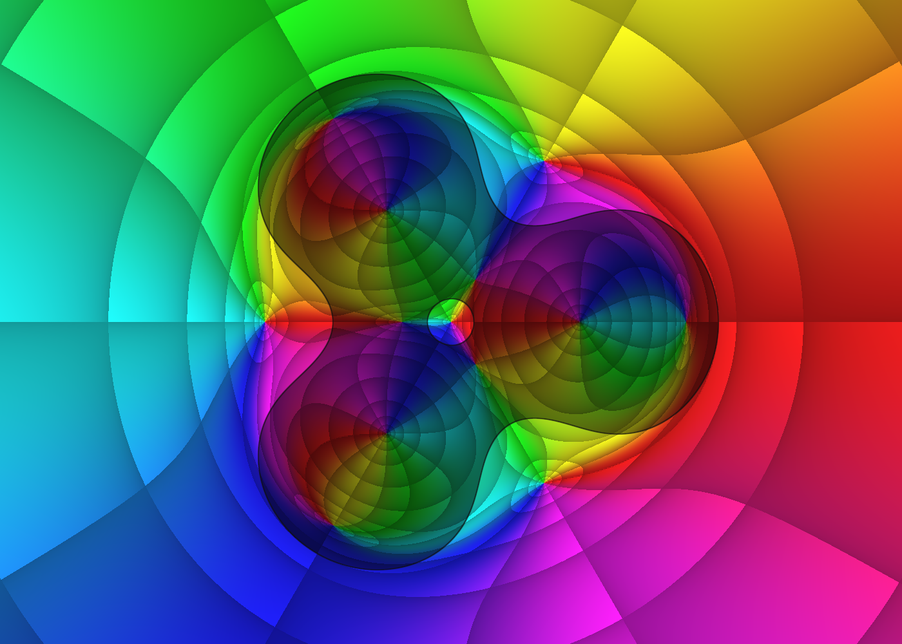
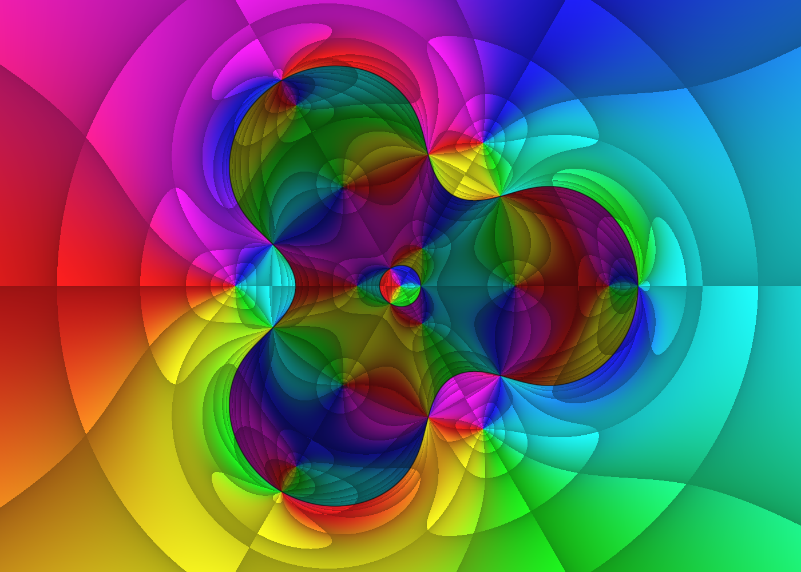
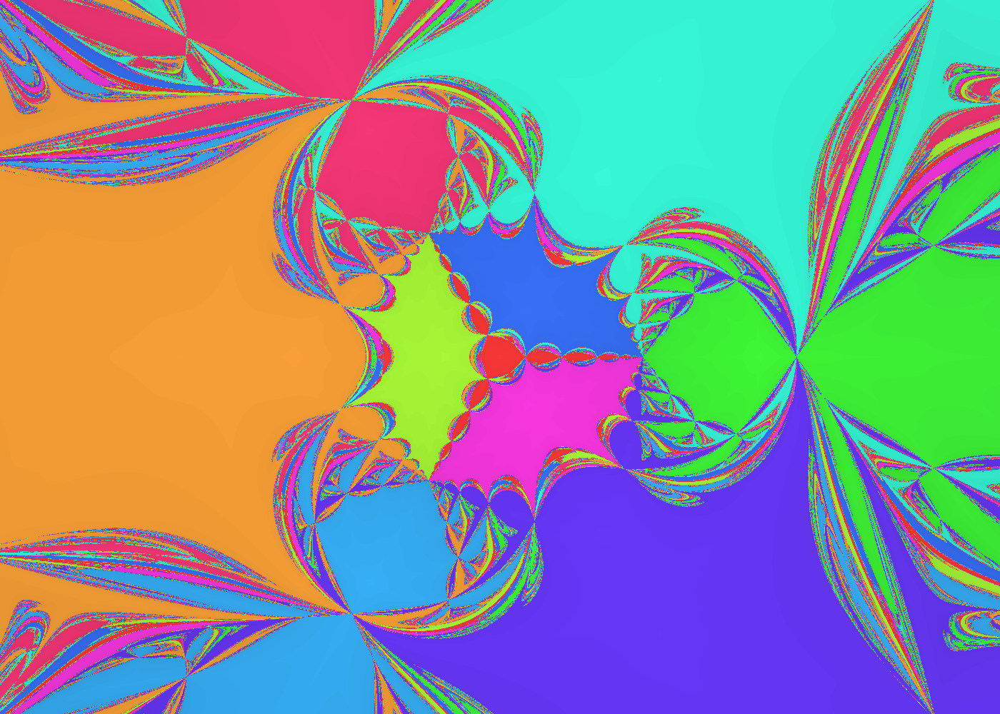

# Kantorovich and harmonic Newton iteration

The attachment applies Newton's method to a complex function that is smooth as a
map of two real variables but is not complex analytic. The theorem and the
pictures answer different questions: the theorem supplies sufficient conditions
for convergence from a starting point; the pictures explore what actually happens
from many starting points.

## 1. Newton means solve the local linear approximation

For a real function, replace the curve near x by its tangent line and find where
that line reaches zero: x_new = x - f(x)/f'(x).
For F: R² -> R², the derivative is a 2 by 2 matrix, so the same rule is

    DF(v) delta = -F(v),       v_new = v + delta.

A Fréchet derivative is this best linear approximation, also defined in more
general normed spaces. A Banach space is a complete normed vector space; R² is
already an example. No infinite-dimensional machinery is needed for this image.

Kantorovich gives a sufficient convergence test using an invertible initial
Jacobian, the size of the first Newton correction, and a bound on variation of
the derivative in a suitable region. In a common normalized form, let
eta = ||DF(v0)^(-1) F(v0)|| and bound
||DF(v0)^(-1)(DF(x)-DF(y))|| <= L ||x-y|| on a convex domain.
If h = L eta <= 1/2 and the closed ball of radius
r = 2 eta/(1 + sqrt(1-2h)) about v0 lies in that domain, the theorem guarantees
convergence under its differentiability hypotheses. This is a sufficient test,
not a statement that every initial point converges. The shader does not compute
L or certify these hypotheses at each pixel.

Reference: [Kantorovich theorem in an ETNA research paper](https://etna.ricam.oeaw.ac.at/vol.17.2004/pp102-111.dir/pp102-111.pdf).

## 2. Why there are two complex derivatives

Write z = x + iy. A general real-linear change in a complex-valued function is

    df = a dz + b conjugate(dz),
    a = (f_x - i f_y)/2,    b = (f_x + i f_y)/2.

These are the Wirtinger derivatives f_z and f_zbar. An analytic function has b=0;
then ordinary complex Newton division works. Otherwise solve the equation and
its conjugate together. This gives

    J = |a|² - |b|²,
    delta = -(conjugate(a) f - b conjugate(f))/J.

J is the determinant of the real Jacobian. Positive J preserves the orientation
of a tiny circle; negative J reverses it. At J=0 the linear map is singular and
this Newton formula is undefined. Near that set, a small input change can produce
a very large Newton step.

## 3. The function in your image

    g(z) = z²/(z³ - 0.216),
    f(z) = z - conjugate(g(z)),
    g'(z) = -z (z³ + 0.432)/(z³ - 0.216)².

The conjugation bar covers the entire fraction. Consequently

    a = 1,    b = -conjugate(g'(z)),
    J = 1 - |g'(z)|²,
    N(z) = z - (f(z) + conjugate(g'(z)) conjugate(f(z)))/J.

The function is harmonic away from its three poles: its real and imaginary
parts satisfy Laplace's equation. It is not analytic. The poles are
0.6 exp(2 pi i k/3), k=0,1,2.

There are ten zeros. One is z=0. For a nonzero root write z=r exp(i theta).
The root equation reduces to (r³-r) exp(3i theta)=0.216. The positive
solution of r³-r=0.216 gives three outer roots; the two positive solutions of
r³-r=-0.216 give six more. Four zeros have J>0 and six have J<0.
A negative determinant does not prevent Newton convergence: invertibility is
what the local Newton step needs.

## 4. Read the three GPU views



**F mode 0: f.** Hue is arg f(z), the direction of the output complex number.
The default contour bands show magnitude and phase. Regions with J<0 are darker;
the thin dark boundary approximates J=0. Both zeros and poles produce color-wheel
patterns, so hue alone cannot distinguish them. Press M for plain phase coloring.



**F mode 1: N(z)-z.** Hue is the direction of the next Newton step; magnitude
bands encode step size. Across J=0 the denominator changes sign and the phase
can jump by pi. Orientation shading still refers to f, not the displacement map.



**F mode 2: basins.** Each pixel starts a Newton orbit. The same base color means
the same limiting root; darker shades mean more iterations. Complicated boundaries
show sensitivity to the starting point. Ten distinct root colors are assigned by
radial family and angular sector. Near-black means unresolved after 80 iterations,
a near-singular Jacobian, a near-pole evaluation, or exceeding the numerical
range limit; it is not proof of mathematical divergence.

Convergence requires |f|<1e-6. Evaluation stops if |z³-0.216|²<1e-20,
|J|<1e-10 before a step, or |z|²>1e16. Boundaries depend on precision, pixel
resolution, and these numerical limits. Basins use double-precision pixel-shader
arithmetic regardless of D. D switches precision of the compute-stage f and g'
used in modes 0 and 1. M, C, and contour density affect phase portraits; basin
colors remain fixed so root identity stays consistent.

The attachment also discusses N³(z)-z: apply N three times, then subtract the
starting point. Where three steps nearly reach a root z*, this resembles z*-z.
That explains why its phase portrait resembles the basin partition. The native
program implements the three main pictured views, not this additional cover view.

## 5. Build, run, verify

From the repository root:

```powershell
.\native\dx12\build.bat kantorovich
.\native\build\kantorovich.exe --fp64
.\native\build\kantorovich.exe --function 2 --snapshot docs/img/kantorovich-basins.png
.\native\build\kantorovich.exe --self-test
.\native\build\kantorovich.exe --fp64 --verify-gpu --snapshot docs/img/kantorovich.png
```

F cycles the views, drag pans, wheel zooms, R resets, P saves a PNG, Esc closes.
I runs the mathematical check (the shared console calls this an invariance check).
The self-test checks the derivative against real finite differences and finds
and classifies the ten roots from a grid of seeds. GPU verification compares f
and g' against the CPU at the shared renderer's three sample pixels; it does not
validate every basin pixel or prove global convergence.

The implementation follows the existing layout: `native/dx12/kantorovich/`
contains the C++ CPU reference and embedded HLSL, `common/` supplies DirectX 12,
the window, controls, coloring and PNG export, and `native/build/` holds outputs.
An identity matrix feeds z into the existing compute pipeline as a single term.
A small optional custom-color hook allows the basin shader to return categorical
colors before the common phase-coloring path.
