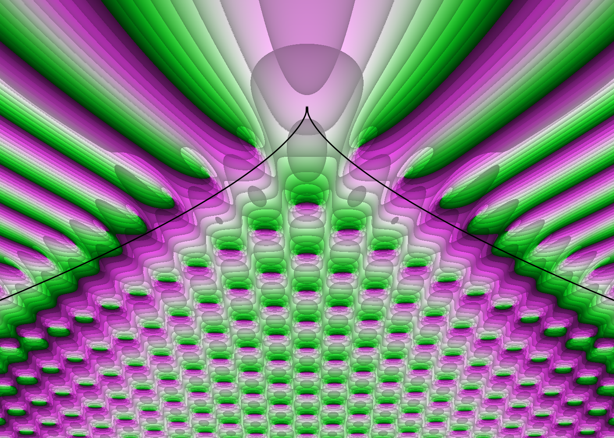

# The Pearcey integral renderer

`native\build\pearcey.exe` draws a phase portrait of the Pearcey integral

```math
\Psi(x, y) = \int_{-\infty}^{\infty} \exp\!\big(i(t^4 + y\,t^2 + x\,t)\big)\,dt
```

over the plane $`z = x + iy`$. The integral is evaluated per pixel on the GPU: every
pixel runs its own quadrature rule along a path in the complex $`t`$-plane.



These notes explain the mathematics and how the code computes it, one topic per file:

1. [The integral](definition.md): the definition, its notation in the DLMF,
   symmetries, closed forms, and the cusp caustic $`27x^2 + 8y^3 = 0`$.
2. [The integration path](contour.md): why the real line cannot be used, and the
   bent path $`t(s) = s + i\delta(s)`$ on which the integrand decays.
3. [Quadrature](quadrature.md): the midpoint rule, why it converges
   exponentially, how the interval is chosen, and the bit-reversed node order
   behind progressive rendering.
4. [GPU evaluation](gpu.md): the HLSL integrand, double-precision `exp`, `sin`
   and `cos` written from scratch, the accumulator, and the caustic overlay.
5. [Verification](verification.md): the checks behind the `I` key and
   `--verify-gpu`, with measured convergence numbers.

## Where the code is

| File | Contents |
|---|---|
| [`native/dx12/pearcey/pearcey.h`](../../native/dx12/pearcey/pearcey.h) | CPU side: path constants, interval half-width, quadrature nodes, the CPU reference `psi`, and the rotated-path check `psiRotated`. |
| [`native/dx12/pearcey/pearcey.cpp`](../../native/dx12/pearcey/pearcey.cpp) | GPU side: the HLSL `term` (integrand at one node), fp64 `exp`/`sin`/`cos`, `plotValue`, the caustic overlay, the `I`-key check, and `main`. |
| [`native/dx12/common/shaders.h`](../../native/dx12/common/shaders.h) | Shared HLSL frame: the per-pixel summation loop and domain colouring. |
| [`native/dx12/common/app.h`](../../native/dx12/common/app.h) | Window, controls, progressive rendering, and GPU verification. |

The common frame was written for sums over group elements $`g \in G`$ (see
[background.md](../background.md)). The Pearcey program reuses it unchanged: its
"group elements" are quadrature nodes, and its "series" is a quadrature sum.

## Quick reference

| Quantity | Value in code | Where |
|---|---|---|
| Path height $`\lambda`$ | `LAMBDA = 0.5` | `pearcey.h` |
| Margin past the stationary points | `MARGIN = 3.0` | `pearcey.h` |
| Half-width of the interval | $`S = 3 + \max(\sqrt{\lvert y\rvert}, \sqrt[3]{\lvert x\rvert/2})`$ | `halfWidth`, `term` |
| Bend scale $`\kappa`$ | $`16 S \lambda^2 = 4S`$ | `psi`, `term` |
| Default node count | 512 (rounded up to a power of two) | `main`, `build` |
| Smallest valid partial sum | 128 nodes | `main` (`minPartial`) |
| Accumulated sums | $`\Psi`$ and $`\partial\Psi/\partial x`$ | `term` |
